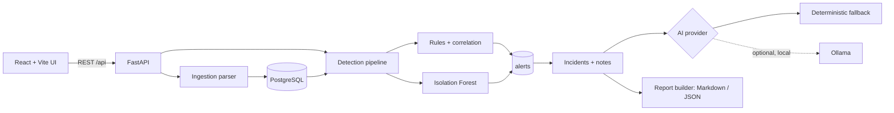

# Architecture

**Framework-independent core** (`app/domain.py`, `ingestion/`, `detection/`, `ml/`, `mitre/`, `ai/`, `reporting/`, `services/context.py`) works on plain dataclasses/dicts, so it is unit-tested without a database or web server. **Web/DB layer** (`api/`, `db/`, `services/*`) adapts it to FastAPI + SQLAlchemy.

Design decisions: alerts are deduplicated by fingerprint; analyst status survives re-runs; evidence is a many-to-many link (capped at 500 events/alert, true total stored); timestamps are UTC; the AI context is bounded and built from stored data; reports are deterministic given the same inputs and `generated_at`.
